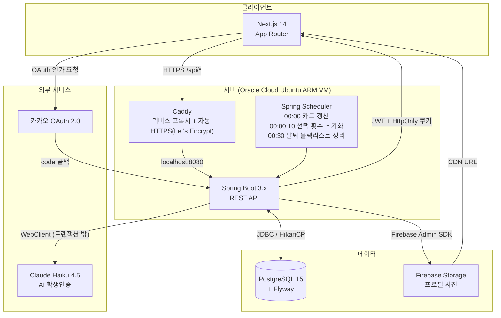
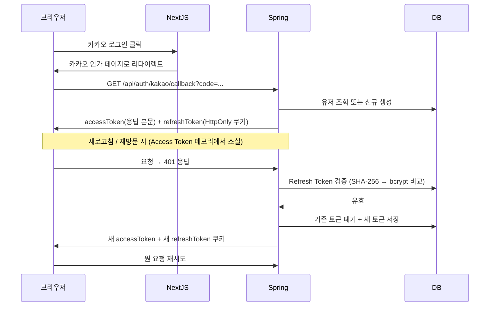
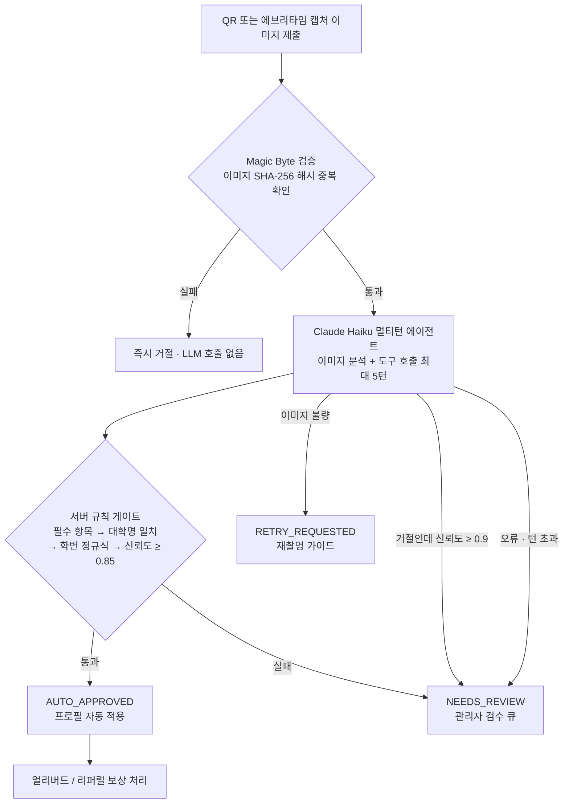

# 캠퍼스 한장 (CampusHanjang)

> **사진 한 장으로 느낌을 보고, 이상형이 맞으면 바로 연결** — 축제 번호 부스의 디지털화

축제 기간의 매칭 부스 이벤트는 무작위로 번호를 뽑아 상대를 정하다 보니, 서로 맞지 않는 사람이 이어져 만남이 금방 끝나는 경우가 많습니다.

캠퍼스 한장은 참가자가 입력한 이상형 조건을 바탕으로 매칭률을 계산해 상대를 추천합니다. 운에 기대던 매칭을 취향이 맞는 사람과의 만남으로 바꿔, 짧은 축제 기간에도 의미 있는 인연을 만들 수 있게 합니다.
<br>

## 📦 Repositories

| 레포 | 설명 | 스택 |
| --- | --- | --- |
| [campus_hanjang_server](https://github.com/seungjinBen/campus_hanjang_server) | 백엔드 API 서버 | Java · Spring Boot |
| [campus_app](https://github.com/seungjinBen/campus_app) | 프론트엔드 웹 | TypeScript · Next.js |
| [CampusHanjangTIL](https://github.com/seungjinBen/CampusHanjangTIL) | 배포 후 사용자 경험 개선사항 | |

## 개발 기간 및 역할

| 항목 | 내용 |
|------|------|
| **성과** | 봄·가을 2시즌 누적 가입 568명 · 선택 1,297건 · 연락처 공개율 63.6% → 27.9%(임계치 조정) · 쪽지 수락률 23.5%. 가을 시즌에 투입한 학생인증 LLM 에이전트는 자동승인율 73% · 평균 처리 7.2초 · 자동승인 270건 중 사후 롤백 0건으로 운영 |
| 기간 | 2026.03 ~ 2026.05 (1차 봄 시즌) / 2026.08 ~ 2026.10 (2차 가을 시즌) |
| 팀 구성 | FE/BE 1인 (풀스택) |
| 담당 | 기획·설계·백엔드·프론트엔드·인프라·유저 CS 전 영역 |
| 서비스 URL | https://www.campushanjang.kr/ |

[](https://openjdk.org/)
[](https://spring.io/projects/spring-boot)
[](https://nextjs.org/)
[](https://www.postgresql.org/)

---

## 목차

1. [서비스 소개](#1-서비스-소개)
2. [핵심 기능](#2-핵심-기능)
3. [기술 스택](#3-기술-스택)
4. [아키텍처](#4-아키텍처)
5. [트러블슈팅](#5-트러블슈팅)
6. [운영 데이터로 검증한 것](#6-운영-데이터로-검증한-것)
7. [ERD](#7-erd)
8. [API 명세](#8-api-명세)

---

## 1. 서비스 소개

**캠퍼스한장**은 세종대학교 재학생만 가입할 수 있는 사진 및 이상형 기반 매칭 서비스입니다.

### 개발 배경

대학 축제의 번호 부스는 수백 명이 줄을 서는 인기 행사지만, 행사가 끝나면 흔적이 남지 않습니다. "딱 한 번의 기회"를 시즌 서비스로 확장하면서, 동시에 **재학생임을 증명해야만 접근**할 수 있는 신뢰 기반 공간을 만드는 것이 목표였습니다.

1차 봄 시즌은 학생인증을 운영자가 직접 처리했고, 2차 가을 시즌에 LLM 에이전트로 자동화해 재런칭했습니다.

### 타겟 유저

- 세종대학교 재학생 (학생인증 필수)
- 자기 학과 외의 사람과 자연스럽게 인연을 만들고 싶은 대학생

### 서비스 흐름

```
카카오 로그인 → 학생인증(세종대 앱 QR 캡처 또는 에브리타임 프로필 캡처 → AI 판정)
→ 프로필 작성 → 사진 등록 → 특징 입력 → 이상형 설정
→ 매일 자정: 새 카드 10장 제공 → 하루 선택(기본 2회, 얼리버드·리퍼럴 보너스 포함 최대 4회)
→ 이상형 일치율 75% 이상 시 연락처 즉시 공개, 미만 시 쪽지
```

---

## 2. 핵심 기능

### ① AI 학생인증 — Claude API 멀티턴 에이전트 + 서버 규칙 게이트

학생 앱의 QR 화면 또는 에브리타임 프로필 화면을 캡처해 제출하면, Claude Haiku가 이미지에서 대학명·이름·학번·학과·생년월일을 추출합니다. 세종대 QR 경로에서는 도구 두 개(학번 중복 조회 `check_student_no`, 학과 사전 조회 `search_department`)를 모델이 호출하고 서버가 실행해 결과를 돌려주며, 최대 5턴까지 반복합니다.

모델 출력은 후보로만 취급합니다. **서버 규칙 게이트(필수 항목 존재 → 대학명 일치 → 학번 정규식 → 신뢰도 ≥ 0.85)를 통과해야만** 자동 승인이 확정되고, 거절 판정인데 신뢰도가 0.9 이상이면 화면 오판 가능성을 보고 수동 검토로 내립니다. 어떤 예외에서도 수동 검토로 폴백합니다.

### ② 일일 매칭 카드 시스템 — Spring Scheduler + 비관적 락

매일 자정 스케줄러가 활성 유저 전원에게 이성 후보 10장을 생성합니다. 이상형 일치율을 미리 계산해 카드에 포함하고, 스케줄러 이후 가입한 유저의 첫 조회는 온디맨드로 생성하되 유저 행 비관적 락으로 직렬화해 동시 요청으로 인한 중복 생성을 차단합니다.

### ③ 이상형 매칭 점수 분기 — MatchScoreUtil

선택받은 사람의 이상형 조건 vs 선택한 사람의 실제 특징을 **0.0 ~ 1.0** 점수로 계산합니다. 카드에 고정된 점수가 **0.75 이상**이면 연락처를 즉시 공개하고, **미만**이면 50자 이내 쪽지 작성 UI로 분기합니다. 1차 시즌 운영 데이터를 보고 임계치를 조정해 연락처 공개율을 63.6%에서 27.9%로 목표 범위에 맞췄습니다.

### ④ 토큰 회전 + 연락처 암호화 — JWT Rotation + AES-256-GCM

Refresh Token은 사용할 때마다 새 토큰으로 교체되고 기존 토큰은 즉시 폐기됩니다. 폐기된 토큰이 재사용되면 해당 유저의 모든 세션을 강제 차단합니다. 연락처는 매번 랜덤 nonce를 생성하는 AES-256-GCM으로 암호화해 저장하고, 공개 조건을 통과한 응답에서만 복호화합니다.

### ⑤ 계층형 Rate Limiting — Bucket4j + Caffeine

IP 전역 제한(분당 100회), 로그인 경로 제한(IP당 시간당 10회), 유저·작업별 제한(학생인증 제출 시간당 5회, 카드 조회 분당 30회, 선택 시간당 10회, 쪽지 시간당 20회 등)을 따로 관리합니다. 학생인증은 LLM 비용 때문에 가장 엄격하게 제한하고, 그 위에 이미지 해시 중복 차단을 한 번 더 둡니다.

---

## 3. 기술 스택

### 백엔드

| 기술 | 선택 이유 |
|------|-----------|
| **Java 17** | Record, sealed class, text block으로 DTO와 분기 로직을 간결하게 표현. 런타임은 JDK 21. |
| **Spring Boot 3.x** | Spring Security 6의 Lambda DSL로 SecurityFilterChain 구성이 명시적. Jakarta EE 9 기반으로 최신 표준 준수. |
| **Spring Data JPA + Flyway** | 스키마 변경을 V1~V16 마이그레이션 파일로 이력 관리. `ddl-auto=validate`로 엔티티와 스키마가 어긋나면 기동 시점에 실패. "1학번 1계정" 같은 규칙은 JPA가 표현 못 하는 부분 유니크 인덱스를 SQL로 직접 정의. |
| **Bucket4j + Caffeine** | 단일 서버라 Redis 없이 JVM 내 Rate Limiting. 만료 버킷을 TTL로 자동 축출해 메모리 누수 없음. |
| **AES-256-GCM** | CBC와 달리 인증 태그(128bit)로 무결성까지 보장. 매 암호화마다 랜덤 nonce를 생성해 동일 평문도 다른 암호문 생성. |
| **JJWT 0.12** | typ 클레임으로 Access/Refresh 토큰 타입을 구분. token type confusion 공격을 라이브러리 레벨에서 차단. |
| **Firebase Admin SDK** | 이미지를 서버 디스크에 저장하지 않고 메모리 → Firebase로 직행. 스토리지와 CDN을 직접 관리할 인프라 없이 확장성 확보. |
| **Claude Haiku 4.5 (WebClient)** | 이미지 판독 + 학번/학과 도구 호출을 하나의 에이전트 루프로 처리. 429·5xx는 지수 백오프로 3회 재시도. 속도와 비용 균형상 Haiku 선택. |
| **ImageMagick + TwelveMonkeys** | Java ImageIO가 HEIC를 지원하지 않아 ImageMagick 프로세스 호출로 변환. iPhone Display P3 ICC 프로파일 JPEG는 TwelveMonkeys로 처리. |
| **k6 · Python** | 배포 전 50→500→1,000 VU 단계 부하 테스트. 운영 종료 후 SQL·Python으로 설계 결정을 사후 검증. |

### 프론트엔드

| 기술 | 선택 이유 |
|------|-----------|
| **Next.js 14 (App Router)** | Server Component로 초기 HTML 생성 → LCP 개선. 미들웨어 레이어에서 Refresh Token 쿠키만으로 라우트 가드 구현 가능. |
| **TypeScript 5 (strict)** | API 응답 타입(`ApiResponse<T>`)을 공유해 백엔드 계약과 프론트 타입을 동기화. runtime 오류를 컴파일 타임에 차단. |
| **Zustand** | Access Token을 메모리(store 상태)에만 보관하기 위해 선택. Redux의 보일러플레이트 없이 전역 인증 상태 관리. |
| **Axios Interceptor** | 401 응답을 자동 감지해 Refresh Token 쿠키로 재발급 후 실패한 요청들을 큐에서 재시도. 인증 갱신 로직을 각 API 호출에서 분리. |
| **React Hook Form + Zod** | 온보딩 5단계 폼의 유효성 검사를 서버 스키마와 동일한 규칙으로 클라이언트 선검증. 불필요한 API 호출 차단. |
| **heic2any** | iOS 기기에서 파일 선택 시 HEIC가 그대로 오는 경우를 클라이언트에서 JPEG로 변환. 서버 처리 전 선제 대응. |

---

## 4. 아키텍처

### 전체 서비스 구조



요청은 `RateLimitFilter`(IP) → `JwtAuthFilter` → `@UserRateLimit` AOP(유저·작업별) → 컨트롤러 → 서비스 순으로 통과합니다. 패키지는 `domain/{auth, user, match, photo, verification, referral, admin}` 도메인별로 나누고, 보안·예외·AOP처럼 도메인과 무관한 것만 `common/`에 둡니다.

### 인증 흐름



### 학생인증 에이전트 흐름



LLM 호출은 의도적으로 `@Transactional` 밖에서 실행합니다. 수십 초 걸리는 호출이 HikariCP 커넥션(풀 10개)을 점유하지 않도록, 해시 검사 → LLM 호출 → 짧은 저장 트랜잭션 순으로 분리했습니다. 판정마다 확신도·LLM 호출 횟수·처리 시간·도구 호출 이력(JSONB)을 저장해 운영 후 집계할 수 있게 했습니다.

---

## 5. 트러블슈팅

### 1. 피크 시간마다 서버가 죽는 문제 — Caffeine 캐시 무한 증가

**문제**
1차 봄 시즌, 축제 기간 피크 시간마다 Java 프로세스가 종료됐습니다. AWS EC2 t3.micro에서 총 8번 재시작했습니다.

**원인 특정**
`journalctl`에서 oom-kill을 확인해 메모리 부족까지 좁히고, heap dump를 떠서 가장 큰 객체를 따라가니 Caffeine 캐시 맵이 대부분을 차지하고 있었습니다. 캐시에 TTL과 최대 크기를 두지 않아 엔트리가 무한히 쌓이고 있었습니다.

**해결 방법 선택 이유**
캐시 설정(maximumSize + expireAfterWrite), Swap 2GB, 인스턴스 증설(t3.small) 세 가지를 한 번에 적용하면 무엇이 효과였는지 알 수 없어, 하나씩 적용하고 다음 피크에서 재발 여부를 확인했습니다. 원인을 모른 채 인스턴스만 키우면 다음 피크에 또 죽을 것이라 보고 캐시 설정을 먼저 적용했습니다.

**결과**
2차 가을 시즌 전 기간 무중단(종료 8회 → 0회). 이후 모든 Caffeine 캐시(Rate Limit 버킷 포함)에 TTL과 최대 크기를 기본으로 둡니다.

---

### 2. 카드 한 페이지에 쿼리 22개가 나가는 문제 — N+1

**문제**
오늘의 카드 10장을 조회할 때 카드마다 후보 유저·사진·특징 테이블을 개별 조회하는 N+1로 쿼리가 22개 나갔습니다.

**원인 특정**
k6 부하 테스트(50 → 500 → 1,000 VU 단계)에서 1,000 VU 스파이크 구간에 5xx가 59건 발생했고, 쿼리 수가 많아 커넥션 점유 시간이 길어진 것이 원인이었습니다.

**해결 방법 선택 이유**
fetch join으로 후보 유저와 특징을 한 번에 가져오고, 컬렉션이 여러 개라 fetch join을 중첩할 수 없는 사진은 ID 목록을 모아 IN 절로 일괄 조회해 애플리케이션에서 합쳤습니다. 쿼리는 4개로 줄었습니다.

**결과**
실제 피크 수준인 50 VU에서 p95 1.05초 → 0.29초, 500 VU에서 7.1초 → 2.9초, 1,000 VU 스파이크에서 5xx 59건 → 0건. 이 테스트는 요청 제한을 풀고 커넥션 풀을 50으로 늘린 개발 프로필의 스트레스 조건이며, 운영은 유저당 분당 30회 제한이 있어 같은 폭주는 들어오지 않습니다. 목적은 속도보다 축제 피크에서 죽지 않는지를 배포 전에 확인하는 것이었습니다. 스크립트와 결과는 `k6/` 폴더에 있습니다.

---

### 3. 동시 선택 요청으로 하루 제한 초과

**문제**
부하 테스트 중 동일 유저가 0.1초 간격으로 선택 요청 2건을 동시에 보내면, 하루 한도(기본 2회, 보너스 포함 최대 4회)에 도달했는데도 두 요청이 모두 통과했습니다.

**원인 특정**
`MatchService.select()`가 `user.getDailySelectCount()`를 읽은 뒤 `incrementSelectCount()`를 호출하기까지의 간격에, 두 번째 트랜잭션이 아직 갱신 전인 값을 읽어 두 요청 모두 "한도 미만"으로 판단했습니다. JPA 낙관적 락(`@Version`)도 고려했지만 버전 충돌 후 재시도 로직까지 구현해야 하고, 선택은 하루 몇 번뿐인 저경합 연산이라 비관적 락이 단순했습니다.

**해결 방법 선택 이유**
`UserRepository.findByIdForUpdate()`에 `@Lock(LockModeType.PESSIMISTIC_WRITE)`와 JPQL을 붙여 유저 행에 SELECT FOR UPDATE를 적용하고, `select()` 첫 줄의 조회만 이 메서드로 교체했습니다. 서비스 로직은 그대로 두고 같은 유저의 요청만 직렬화됩니다. 한 트랜잭션이 잠그는 행은 본인 행 하나뿐이라 데드락 조건이 성립하지 않습니다. 온디맨드 카드 생성(`getTodayCards`)의 중복 생성 방지에도 같은 메서드를 씁니다.

**결과**
동시 선택 100회 반복 테스트에서 하루 제한 초과 0건. 재선택(같은 후보를 다시 선택)은 멱등 처리로 횟수 차감 없이 기존 결과 반환. 쪽지는 선택 1건당 1건만 허용하도록 존재 검사(`existsBySelectorIdAndSelectedId`)로 막았고, 선택 횟수처럼 한도가 걸린 연산이 아니라 락이나 유니크 제약까지는 두지 않았습니다.

---

### 4. 같은 이미지를 반복 제출하면 호출마다 과금되는 문제

**문제**
스테이징에서 동일한 학생증 이미지를 20번 제출하자 Claude API 호출이 20번 전부 발생했습니다.

**원인 특정**
학생인증 엔드포인트에 시간당 5회 제한이 있었지만, 계정 단위 제한이라 계정을 바꾸면 우회됐고, 이미 승인된 이미지를 다른 계정에서 재사용하는 경우도 막지 못했습니다.

**해결 방법 선택 이유**
이미지를 수신하는 즉시 SHA-256 해시를 계산해 `student_verifications.image_hash`에 저장하고, LLM 호출 전에 동일 해시가 있으면 즉시 거절합니다. 해시 계산은 수 밀리초로, 이미지를 디코딩하거나 저장하는 것보다 훨씬 빠릅니다. 계정 단위 제한(Rate Limit)과 입력 내용 단위 제한(해시)을 겹쳐 둔 구조입니다.

**결과**
이후 중복 제출로 인한 Claude API 호출 0건.

---

### 5. 모델이 없는 값을 채우거나 정상 화면을 거절하는 문제

**문제**
에브리타임 화면에는 학과와 생년월일이 없는데 모델이 추측해 채우는 경우가 있었고, 반대로 화면 종류를 오판해 정상 학생을 거절하기도 했습니다. 두 문제는 방향이 반대라 프롬프트만으로 한쪽을 잡으면 다른 쪽이 나빠졌습니다.

**해결 방법 선택 이유**
규칙을 서버로 가져왔습니다. 에브리타임 경로에서는 서버가 학과·생년월일 필드를 무조건 비우고, 거절 판정인데 확신도가 0.9 이상이면 오히려 수상하다고 보고 수동 검토로 내립니다. 승인은 자동화 기준을 엄격하게, 거절은 사람이 한 번 보게 하는 비대칭 처리입니다. 정상 학생이 서비스를 못 쓰는 비용이 더 크기 때문입니다.

**결과**
자동거절은 5.1%에 머물렀고 운영 중 오승인 신고는 없었습니다.

---

### 6. bcrypt의 72바이트 절단 문제 — Refresh Token 해싱

**문제**
Refresh Token을 `BCryptPasswordEncoder.encode(token)`으로 저장했더니, 72바이트 뒤가 잘려 서로 다른 토큰이 같은 해시를 가질 수 있었고 Spring Security 6.5부터는 초과 입력에 예외가 발생했습니다.

**해결 방법 선택 이유**
저장 전에 SHA-256으로 토큰을 44자(Base64) 문자열로 줄인 뒤 bcrypt를 적용했습니다. 토큰 자체가 충분히 긴 무작위 서명을 포함해 추가 키 관리 없이도 역산 가능성이 없어 HMAC 대신 SHA-256을 택했습니다.

**결과**
Refresh Token 비교 실패 0건. SHA-256 후 bcrypt 저장 패턴을 `security/JwtProvider`에서 강제.

---

### 7. iOS HEIC / Live Photo 이미지 처리 실패

**문제**
iPhone 기본 카메라로 촬영한 프로필 사진을 업로드하면 `javax.imageio.IIOException: Not a JPEG file`이 발생하거나, JPEG 변환은 성공해도 색상이 녹색·분홍색으로 왜곡됐습니다.

**원인 특정**
1. **HEIC/HEIF**: Java 표준 ImageIO가 지원하지 않는 포맷. `Content-Type`을 신뢰하면 JPEG인 척 업로드된 파일을 처리하지 못함.
2. **색상 왜곡**: iPhone JPEG의 ICC 프로파일이 `Display P3`인데 기본 ImageIO는 `sRGB`로 처리해 색상 공간 변환 없이 픽셀값을 그대로 씀.

**해결 방법 선택 이유**
- HEIC: magic byte로 포맷을 확인한 후 ImageMagick을 서버 프로세스로 실행해 메모리 파이프로 JPEG 변환. 임시 파일 경쟁이나 정리 누락으로 인한 디스크 소진을 막기 위해 디스크에 쓰지 않는 방식을 택함.
- 색상 왜곡: TwelveMonkeys ImageIO를 추가해 P3 → sRGB 변환을 자동 처리. ImageIO 플러그인 방식이라 기존 코드 수정 없이 classpath 추가만으로 적용.

**결과**
iPhone 15 Pro(HEIF), iPhone SE(HEIC), Live Photo(MOV 첫 프레임) 세 케이스 모두 색상 정확한 JPEG 저장. 서버 디스크 임시 파일 0개.

---

### 8. Access Token 탈취 대응 — 메모리 보관 + Refresh Token 회전

**문제**
초기 설계에서 Access Token을 `localStorage`에 저장했는데, XSS 취약점이 하나라도 있으면 30일짜리 Refresh Token까지 탈취될 수 있었습니다.

**해결 방법 선택 이유**
- **Access Token → Zustand 메모리**: 새로고침 시 소멸하지만 401 시 인터셉터가 자동 재발급하므로 UX 저하 없음.
- **Refresh Token → HttpOnly + Secure + SameSite=Strict 쿠키**: JavaScript로 읽기 불가. CSRF는 SameSite=Strict가 차단.
- **Refresh Token 회전**: 탈취된 토큰으로 공격자가 갱신하면 진짜 사용자의 다음 갱신에서 폐기 토큰 재사용이 감지돼 해당 유저의 모든 Refresh Token 즉시 폐기.

**결과**
XSS 발생 시에도 Access Token은 15분 수명, Refresh Token은 쿠키 특성상 스크립트 탈취 불가.

---

## 6. 운영 데이터로 검증한 것

인증 결과마다 저장한 확신도·호출 횟수·처리 시간을 시즌 종료 후 SQL로 집계했습니다. 재현 쿼리와 스크립트는 `analysis/` 폴더에 있습니다.

| 지표 | 결과 |
|---|---|
| 학생인증 판정 분포 | 자동승인 73% · 자동거절 5.1% · 수동검토 18% · 운영자 직접 판단 3.8% |
| 평균 처리 시간 | 7.2초 (세종대 QR 경로가 도구 호출 턴 때문에 에브리타임 경로보다 느림) |
| 자동승인 사후 롤백 | 270건 중 0건 (사용자 신고·운영자 샘플 검사 기준) |
| 확신도 분포 | 자동승인 평균 0.98, 수동검토 평균 0.95 |

확신도 임계치를 조정해 자동승인율을 높이려던 계획은 접었습니다. 자동승인과 수동검토의 평균 확신도가 0.98과 0.95로 갈리지 않아, 임계치로는 두 집단을 구분할 수 없다고 판단했기 때문입니다. 대신 수동검토로 내려간 건의 원인을 분류해 학번 중복·학과 식별 게이트 개선으로 우선순위를 바꿨습니다.

---

## 7. ERD

```mermaid
erDiagram
    users {
        uuid id PK
        bigint kakao_id UK
        varchar nickname
        varchar gender
        date birth_date
        varchar university
        varchar contact_type
        text contact_value_encrypted
        int daily_select_count
        boolean is_early_bird
        boolean is_student_verified
        varchar verified_department
        varchar dept_filter_mode
        varchar referral_code UK
        timestamp created_at
    }

    user_traits {
        uuid id PK
        uuid user_id FK
        varchar trait_key
        varchar trait_value
        boolean is_visible
    }

    ideal_traits {
        uuid id PK
        uuid user_id FK
        varchar trait_key
        varchar trait_value
    }

    daily_cards {
        uuid id PK
        uuid user_id FK
        uuid candidate_id FK
        date card_date
        float match_score
        boolean is_viewed
        timestamp created_at
    }

    selections {
        uuid id PK
        uuid selector_id FK
        uuid selected_id FK
        float match_score
        varchar type
        timestamp created_at
    }

    notes {
        uuid id PK
        uuid selector_id FK
        uuid selected_id FK
        varchar note_content
        varchar status
        timestamp responded_at
        timestamp created_at
    }

    student_verifications {
        uuid id PK
        uuid user_id FK
        varchar method
        varchar status
        varchar extracted_name
        varchar extracted_student_no
        varchar extracted_department
        date extracted_birth_date
        float confidence_score
        jsonb agent_actions
        varchar image_hash
        int processing_ms
        int llm_calls
        timestamp created_at
    }

    departments {
        uuid id PK
        varchar name UK
        timestamp created_at
    }

    referral_events {
        uuid id PK
        uuid referrer_id FK
        uuid referee_id FK UK
        varchar status
        date rewarded_at
        timestamp created_at
    }

    withdrawal_blocklist {
        uuid id PK
        varchar kakao_id_hash UK
        timestamp reregistration_allowed_at
    }

    users ||--o{ user_traits : "보유"
    users ||--o{ ideal_traits : "설정"
    users ||--o{ daily_cards : "제공됨"
    users ||--o{ selections : "선택함(selector)"
    users ||--o{ selections : "선택받음(selected)"
    users ||--o{ notes : "보냄(selector)"
    users ||--o{ notes : "받음(selected)"
    users ||--o{ student_verifications : "인증 기록"
    users ||--o{ referral_events : "초대함(referrer)"
    users ||--|| referral_events : "초대받음(referee)"
```

- `student_verifications.extracted_student_no`에는 승인 상태 조건의 **부분 유니크 인덱스**가 있어 "1학번 1계정"을 DB가 보장합니다.
- `daily_cards`는 `(user_id, candidate_id, card_date)` 유니크 제약으로 같은 날 같은 후보의 중복 카드를 막습니다.

---

## 8. API 명세

### 인증 (Auth)

| Method | Endpoint | 설명 | 인증 |
|--------|----------|------|------|
| `GET` | `/api/auth/kakao` | 카카오 OAuth 인가 URL 리다이렉트 | 불필요 |
| `GET` | `/api/auth/kakao/callback` | OAuth 콜백 처리 → JWT 발급 | 불필요 |
| `POST` | `/api/auth/local/login` | 이메일 로그인 (운영자·테스트 계정용) | 불필요 |
| `POST` | `/api/auth/refresh` | Refresh Token으로 Access Token 갱신 (회전) | 쿠키 |
| `POST` | `/api/auth/logout` | 로그아웃 + Refresh Token 폐기 | Bearer |

### 유저 (User)

| Method | Endpoint | 설명 | 인증 |
|--------|----------|------|------|
| `GET` | `/api/users/me` | 내 프로필 조회 | Bearer |
| `GET` | `/api/users/profile-complete` | 프로필 완성 여부 | Bearer |
| `PUT` | `/api/users/profile` | 닉네임·연락처 수정 | Bearer |
| `PUT` | `/api/users/traits` | 특징 수정 | Bearer |
| `PUT` | `/api/users/ideal` | 이상형 수정 | Bearer |
| `PATCH` | `/api/users/dept-filter` | 학과 필터 설정 변경 | Bearer |
| `DELETE` | `/api/users/me` | 회원 탈퇴 + 재가입 차단(카카오 ID 해시 블랙리스트) | Bearer |

### 사진 (Photo)

| Method | Endpoint | 설명 | 인증 |
|--------|----------|------|------|
| `GET` | `/api/photos/me` | 내 사진 목록 | Bearer |
| `POST` | `/api/photos/upload` | 프로필 사진 업로드 (최대 10MB, HEIC 자동 변환) | Bearer |
| `PATCH` | `/api/photos/thumbnail` | 대표 사진 변경 | Bearer |

### 학생인증 (Verification)

| Method | Endpoint | 설명 | 인증 |
|--------|----------|------|------|
| `POST` | `/api/verification/submit` | QR·에브리타임 캡처 제출 → AI 판정 (시간당 5회) | Bearer |
| `GET` | `/api/verification/status` | 내 인증 상태 조회 | Bearer |
| `POST` | `/api/verification/supplementary-info` | 에브리타임 경로 보충 정보 입력 | Bearer |

### 매칭 (Match)

| Method | Endpoint | 설명 | 인증 |
|--------|----------|------|------|
| `GET` | `/api/match/cards` | 오늘의 카드 목록 + 남은 선택 횟수 (분당 30회) | Bearer |
| `POST` | `/api/match/select` | 카드 선택 → 연락처 공개 또는 쪽지 분기 (시간당 10회) | Bearer |
| `POST` | `/api/match/note` | 쪽지 전송 (50자 이내, 시간당 20회) | Bearer |
| `POST` | `/api/match/note/{noteId}/respond` | 받은 쪽지 수락·거절 | Bearer |
| `GET` | `/api/match/received/contacts` | 수신함: 연락처 열람자 목록 | Bearer |
| `GET` | `/api/match/received/notes` | 수신함: 받은 쪽지 목록 | Bearer |
| `GET` | `/api/match/sent/notes` | 보낸 쪽지 목록 | Bearer |

### 리퍼럴 (Referral)

| Method | Endpoint | 설명 | 인증 |
|--------|----------|------|------|
| `GET` | `/api/referral/me` | 내 초대 코드·보상 현황 | Bearer |
| `GET` | `/api/referral/preview` | 초대 코드 미리보기 | 불필요 |

### 관리자 (Admin)

| Method | Endpoint | 설명 | 인증 |
|--------|----------|------|------|
| `GET` | `/api/admin/verification/queue` | 검수 대기 목록 | Admin |
| `GET` | `/api/admin/verification/rejected` | 거절 목록 | Admin |
| `POST` | `/api/admin/verification/{id}/review` | 수동 승인·거절 + 사유 | Admin |
| `GET` | `/api/admin/verification/stats` | 자동승인율·처리시간·큐 크기 | Admin |
| `POST` | `/api/admin/users` | 테스트 유저 생성 | Admin |
| `POST` | `/api/admin/users/{userId}/photo` | 테스트 유저 사진 업로드 | Admin |
| `DELETE` | `/api/admin/match/cards/today` | 오늘 카드 초기화 | Admin |

### 서비스 상태

| Method | Endpoint | 설명 | 인증 |
|--------|----------|------|------|
| `GET` | `/actuator/health` | 헬스체크 (DB·Firebase 상세는 인증 시만 노출) | 불필요 |
| `GET` | `/api/service/status` | 서비스 상태 + 회원 수 | 불필요 |

---

## 배포

`main`에 푸시하면 GitHub Actions가 jar를 빌드해 서버로 복사하고 systemd 서비스를 재시작한 뒤 `/actuator/health`로 성공 여부를 판정합니다. 헬스체크가 실패하면 워크플로우가 실패로 끝나 알림이 옵니다. 에러 로그는 Slack으로, CPU 알람은 클라우드 모니터링으로 받습니다.

| 파일 | 용도 |
|---|---|
| `deploy/setup-server.sh` | Oracle Cloud Ubuntu(ARM) 서버 1회 초기화 (JDK 21, ImageMagick·libheif, Caddy, Swap 2GB, 전용 실행 계정) |
| `deploy/campus-hanjang.service` | systemd 유닛. `.env`를 EnvironmentFile로 읽어 비밀 값 주입 |
| `deploy/Caddyfile` | HTTPS 리버스 프록시 (인증서 자동 발급·갱신) |
| `k6/` | 부하 테스트 스크립트·시드 데이터·결과 |
| `analysis/` | 운영 종료 후 지표 재현 SQL·Python |
